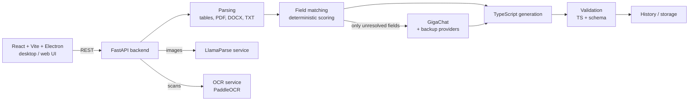

# TSGen: Document-to-TypeScript Transformer Generator

A system that takes a **source file** and a **target JSON structure** and generates a **TypeScript transformer** that maps the source data into the target format, together with a preview of the resulting JSON.

Built for the **Sber hackathon** case (100,000 ₽ prize track). On top of the base task, the case required **PDF processing** and **saving GigaChat tokens**.

## What it does

- **Sources:** CSV, XLSX/XLS, PDF, DOCX, TXT and images.
- **Target:** a JSON example provided as a file, by drag-and-drop or pasted as text.
- **Output:** generated TypeScript code plus a `Preview JSON` built by applying it to the source.
- **Extras:** a preview of the parsed source before generation, manual `source → target` mapping overrides, generation history, explanations of the chosen mappings and quality checks.

## Architecture



| Component | Path | Details |
|---|---|---|
| Frontend | `front/` | React, TypeScript, Vite, optional Electron desktop build; workspace with source upload, target JSON input, generated code, preview and mapping editor; profile and history |
| Backend | `mvp_backend/` | FastAPI, Pydantic; `parsers.py` and `parser/` (pdfplumber, python-docx, openpyxl, PDF zoning and form layout analysis), `generator.py`, `validation.py`, `storage.py`, e-mail verification codes for sign-up |
| LlamaParse service | `llamaparse_service/` | Separate HTTP service for image-like files, so the heavy dependency stays out of the main backend |
| OCR service | `ocr_service/` | PaddleOCR with Cyrillic models and post-processing (checkbox markers, numeric and mixed-script token fixes) |

## Saving GigaChat tokens

Field mapping is resolved **deterministically first**: field names are normalised and tokenised, candidates are scored by name and domain overlap (`matcher.py`, `learning_pipeline.py`), and confirmed user choices are reused. The LLM is called **only for the fields that remain unresolved**, and is asked to rank a short list of candidates instead of producing the whole mapping. Model usage is captured per request (`model_client.py`) and summarised by `tokenomics_report.py`; `benchmarking.py` checks mapping quality on fixed role and graph benchmark sets.

## PDF processing

Documents are classified as table-like, form-like or free text. The parser extracts sections, blocks and candidate fields, detects form layouts and table zones on PDF pages, and falls back to OCR or LlamaParse when the text layer is poor.

## How to run

```bash
docker compose build llamaparse backend frontend
docker compose up -d
# frontend: http://localhost:8080   backend: http://localhost:8000/health
```

Configuration is done through `mvp_backend/.env` (GigaChat credentials, optional backup providers, LlamaParse key, SMTP). A minimal setup works without LlamaParse and SMTP. Detailed setup instructions (in Russian) are in [`docs/README.ru.md`](docs/README.ru.md).

Backend tests: `cd mvp_backend && python -m unittest` (11 test modules).

## Tech stack

Python · FastAPI · Pydantic · pdfplumber · python-docx · openpyxl · PaddleOCR · LlamaParse · GigaChat · TypeScript · React · Vite · Electron · Docker Compose
